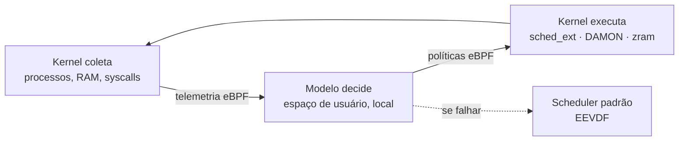

# Lumen OS

**Uma distro Linux From Scratch com um modelo de IA local como coração.**
O modelo orquestra o kernel e aprende, desde a instalação, como você usa o sistema.

> 🚧 **Status:** fase 0 (fundação e estudo). Nada aqui roda ainda. O progresso dia a dia está no [DEVLOG](DEVLOG.md).

## O que é

O Lumen OS é uma distro construída do zero, seguindo o livro [Linux From Scratch](https://www.linuxfromscratch.org/), pensada para desktop pessoal (jogos e desenvolvimento).

No centro dela roda um modelo de IA, 100% local, que decide como o kernel se comporta: quem ganha CPU, o que fica na RAM e o que vai para o swap. Ele começa sem contexto nenhum e vai aprendendo os hábitos de quem usa.

## Por que

Os sistemas operacionais de hoje são criados para um “usuário médio” que simplesmente não existe. A proposta do Lumen é o contrário: aprender como cada pessoa usa o computador e se adaptar a ela, extraindo o melhor que o seu hardware consegue entregar, seja você programador ou gamer casual.

## Como funciona

O modelo é o maestro, o kernel é a orquestra.

- **Scheduler:** via [sched_ext](https://docs.kernel.org/scheduler/sched-ext.html), o app em foco ganha prioridade e latência baixa.
- **RAM:** via DAMON + zram, páginas pouco usadas são comprimidas e os apps que você deve abrir são pré-carregados.
- O modelo decide em milissegundos e o kernel aplica em microssegundos. A IA nunca fica no caminho crítico.

## Autonomia

Cada área (scheduler, RAM e, depois, segurança) evolui por três modos:

| Modo | O que o modelo faz |
|---|---|
| **Observa** | só registra e aprende |
| **Sugere** | propõe ações; cada sim/não do usuário vira dado de treino |
| **Age** | decide sozinho, quando a taxa de acerto passa de ~90% |

O usuário pode rebaixar o modo a qualquer momento.

## Princípios

- **100% local:** nenhum dado do sistema sai da máquina.
- **Transparente:** toda decisão vai para um log, com o motivo.
- **Seguro:** guardrails e volta automática ao kernel padrão se algo der errado.
- **Leve:** o consumo do próprio modelo é medido.
- **Comprovado:** benchmark antes/depois de frame time, travadas e tempo de abertura de apps.

## Roadmap

- [x] Repositório criado
- [ ] **Fase 0:** Git, C e terminal
- [ ] **Fase 1:** LFS puro numa VM
- [ ] **Fase 2:** coletor eBPF (bpftrace → libbpf)
- [ ] **Fase 3:** primeiro modelo (Python + scikit-learn)
- [ ] **Demo 1:** o modelo percebe que um jogo abriu e troca o scheduler sozinho
- [ ] **v1:** scheduler + RAM
- [ ] **v2:** segurança, com antivírus comportamental via BPF LSM
- [ ] **v3+:** orquestrar o kernel inteiro; base imutável (Secure Boot, dm-verity, rollback A/B)

## Trabalhos relacionados

O Lumen OS se apoia em pesquisas que já existem:

- [SchedCP](https://github.com/eunomia-bpf/schedcp) (2025): agentes de LLM que geram e aplicam schedulers via sched_ext.
- **LinnOS** (OSDI 2020): rede neural leve dentro do kernel que prevê latência de SSD.
- **LAKE** (ASPLOS 2023): machine learning acelerado dentro do kernel.

O diferencial aqui é juntar isso numa distro inteira, construída do zero, em que a IA aprende com um único usuário desde o primeiro boot.

## Licença

[GPL-2.0](LICENSE), a mesma do kernel Linux.

---

Feito por Tarcys.
